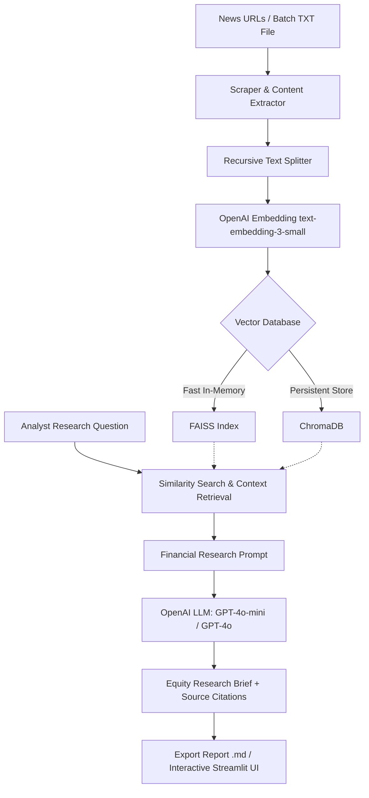

# 📈 AlphaPulse — Equity News Research & Intelligence Tool

> **An AI-powered Financial Intelligence and Retrieval-Augmented Generation (RAG) platform that empowers equity research analysts, portfolio managers, and investment bankers to rapidly index and query financial news, quarterly earnings reports, and SEC filings.**

---

## 🌟 Overview

Equity research analysts often sift through dozens of financial news articles and earnings releases across Bloomberg, Reuters, Yahoo Finance, and CNBC to analyze corporate announcements, management guidance, and margin risks. 

**AlphaPulse** automates this workflow:
1. **Article Ingestion**: Scrapes and cleans financial news articles from URLs or batch text files.
2. **Chunking & Vector Indexing**: Splits text into semantic chunks and creates vector embeddings stored in **FAISS** (in-memory / file serialized) or **ChromaDB** (persistent vector collection).
3. **RAG Question Answering**: Leverages GPT models to synthesize structured equity research briefs (Executive Summary, Key Financial Data, Catalysts & Risks, and Verified Source Citations).
4. **Interactive Dashboard**: Modern Streamlit terminal aesthetic equipped with direct URL input, batch file processing, hyperparameter tuning, and Markdown report export.

---

## 🏗️ Architecture



---

## 🛠️ Tech Stack

- **Frontend & UI**: [Streamlit](https://streamlit.io/) with custom financial dark theme
- **RAG & Orchestration**: [LangChain](https://www.langchain.com/) (Chains, Prompt Templates, Output Parsers)
- **Vector Databases**: 
  - [FAISS (Facebook AI Similarity Search)](https://github.com/facebookresearch/faiss)
  - [ChromaDB](https://www.chromadb.com/)
- **LLM & Embeddings**: [OpenAI API](https://platform.openai.com/) (`gpt-4o-mini`, `gpt-4o`, `text-embedding-3-small`)
- **Web Extraction**: `BeautifulSoup4`, `requests`, `lxml`
- **Containerization & Deployment**: Docker, Docker Compose

---

## ✨ Features & Customizations

### 1. 🌐 Flexible Ingestion Modes
- **Direct URLs**: Enter 1 to 3 live article URLs directly in the sidebar.
- **Offline / Batch Processing Mode**: Upload a `.txt` file containing news URLs (one per line) or paste raw URL lists. Click **⚡ Ingest & Index** to ingest all articles simultaneously.
- **Sample Pre-fill**: Built-in 1-click button to load sample tech earnings articles (Apple, NVIDIA, Microsoft, Alphabet, Tesla).

### 2. 🗄️ Vector Database Switcher
- Seamlessly toggle between **FAISS** and **ChromaDB**.
- Persistent local storage under the `data/` directory so indexed articles persist across sessions.
- In-app **Reset DB** button to wipe vector indexes and start fresh.

### 3. 🎯 Equity Analyst Prompt Engineering
- Formats answers into institutional equity research structures:
  - **Executive Summary**
  - **Key Financial & Market Data**
  - **Strategic Insights & Catalyst Analysis**
  - **Source Attribution** with direct link cards and relevance scores.

### 4. 📑 Export Capabilities
- Download research answers along with context citations as a `.md` research brief with one click.

---

## 🚀 Quickstart: Local Setup

### 1. Prerequisites
- Python 3.10 or 3.11 installed
- Git
- OpenAI API Key

### 2. Clone and Setup Environment
```bash
# Clone the repository
git clone https://github.com/your-username/equity-research-tool.git
cd "equity-research-tool"

# Create a virtual environment
python -m venv .venv

# Activate virtual environment
# Windows:
.venv\Scripts\activate
# macOS/Linux:
source .venv/bin/activate

# Install dependencies
pip install -r requirements.txt
```

### 3. Configure Environment Variables
Copy `.env.example` to `.env`:
```bash
cp .env.example .env
```
Open `.env` and add your OpenAI API key:
```ini
OPENAI_API_KEY=sk-proj-yourActualOpenAIApiKeyHere
```
*(Alternatively, you can enter the API key directly in the Streamlit web interface sidebar).*

### 4. Run the Application
```bash
streamlit run app.py
```
Open your browser at `http://localhost:8501`.

---

## 🐳 Deployment Guide

### Option 1: Docker Deployment (Recommended for Production)

#### Using Docker:
```bash
# Build the Docker image
docker build -t equity-research-tool:latest .

# Run container with your OpenAI API key
docker run -d -p 8501:8501 -e OPENAI_API_KEY="your_api_key_here" -v $(pwd)/data:/app/data --name equity_terminal equity-research-tool:latest
```

#### Using Docker Compose:
```bash
# Set your API key in .env, then run:
docker-compose up -d --build
```
Access the application at `http://localhost:8501`.

---

### Option 2: Streamlit Community Cloud (Free 1-Click Cloud Deploy)

1. Push your repository to **GitHub**.
2. Visit [share.streamlit.io](https://share.streamlit.io/) and connect your GitHub account.
3. Select your repository, branch (`main`), and main file path (`app.py`).
4. In **Advanced Settings**, add your secret:
   ```toml
   OPENAI_API_KEY = "your_actual_openai_key"
   ```
5. Click **Deploy!** Your tool is now live on the web with a public URL.

---

### Option 3: Deploy to Render / Cloud Run / Hugging Face Spaces

- **Hugging Face Spaces**: Create a new Streamlit space, push the repository files, and add `OPENAI_API_KEY` under Settings -> Variables and secrets.
- **Render / AWS ECS / GCP Cloud Run**: Use the provided `Dockerfile` which includes healthcheck endpoints and optimized caching.

---

## 📂 Project Structure

```
├── .streamlit/
│   └── config.toml           # Sleek dark navy/emerald financial terminal theme
├── core/
│   ├── __init__.py
│   ├── config.py             # Global constants, directory paths, models
│   ├── scraper.py            # Robust HTML scraping with custom headers & parsing
│   ├── vector_store.py       # Dual FAISS & ChromaDB manager with persistence
│   ├── rag_engine.py         # Equity Research prompt templates & RAG pipeline
│   └── utils.py              # URL extraction, batch file parsing, validation
├── data/                     # Local persistence directory for FAISS & ChromaDB
├── sample_data/
│   └── sample_urls.txt       # Pre-curated financial news articles for instant testing
├── app.py                    # Streamlit interactive application
├── requirements.txt          # Production dependencies
├── Dockerfile                # Production container specification
├── docker-compose.yml        # Docker compose configuration
├── .env.example              # Environment variable template
└── README.md                 # Documentation and deployment instructions
```

---

## 🧪 Sample URLs for Testing
You can use the built-in sample URLs in `sample_data/sample_urls.txt`:
- Apple Q4 Results: `https://finance.yahoo.com/news/apple-reports-fourth-quarter-results-203000624.html`
- NVIDIA Fiscal Q3 Earnings: `https://finance.yahoo.com/news/nvidia-announces-financial-results-for-third-quarter-fiscal-2025-212000551.html`
- Microsoft Q1 Results: `https://finance.yahoo.com/news/microsoft-reports-first-quarter-results-200500123.html`

---

## 📄 License
This project is open-source and available under the [MIT License](LICENSE).
